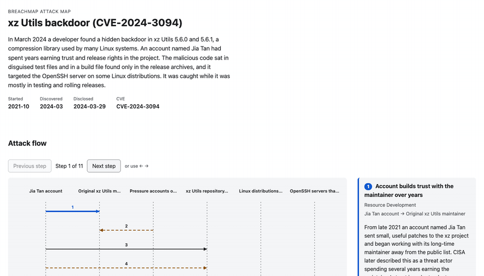

# Breachmap

Turn a real security incident into a sourced, interactive attack map: one offline HTML file.



## Setup

Needs Node 26 and pnpm 12.

```sh
nvm install
pnpm install
```

## Quickstart

1. In Claude Code, in this repo, ask: "map the xz backdoor". The `breachmap` skill researches it
   and writes `gallery/incidents/<id>.json`.
2. Check it: `pnpm breachmap validate gallery/incidents/<id>.json`
3. Render it: `pnpm breachmap render gallery/incidents/<id>.json -o gallery/maps/<id>.html`,
   then open the HTML file.

No agent? `pnpm breachmap new my-incident` writes a starter file to fill in.

## Limitations

- A map is a draft until a person reviews it and sets `provenance.reviewedBy`. Every step links
  its sources so you can check it.
- It explains attacks and defenses only. No exploit code or reproduction steps.
- English only. ATT&CK technique ids are checked by format, not against the ATT&CK catalogue.
- `validate` works offline, so it does not check that source links still work.

## Scripts

- `pnpm check`: lint, type-check and test everything
- `pnpm breachmap <command>`: run the CLI from source (`validate`, `render`, `new`)
- `pnpm build`: bundle the CLI

## License

[MIT](LICENSE)
